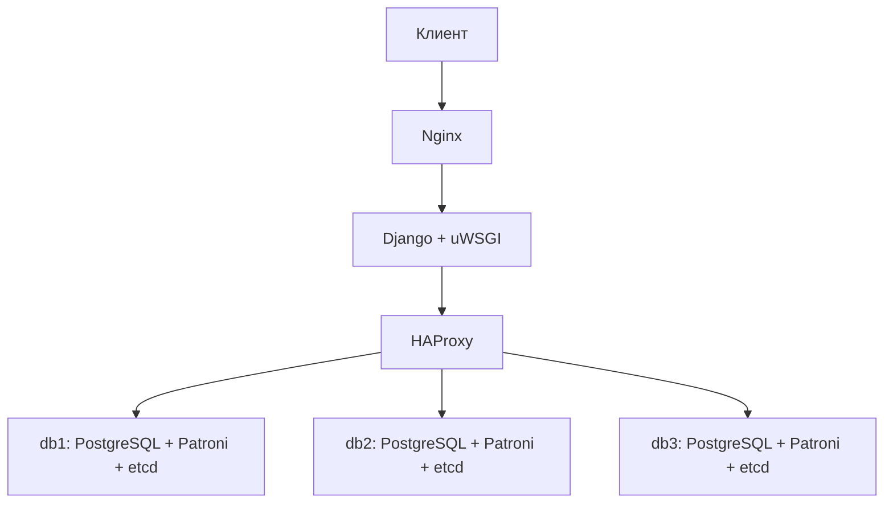

# ДЗ06. Кластер PostgreSQL с Patroni

## Цель работы

Развернуть отказоустойчивый кластер PostgreSQL с автоматическим управлением
лидерством через Patroni. Настроить etcd и HAProxy, перенести базу веб-портала
из ДЗ04 и проверить работу приложения при выключении ведущего узла.

## Реализованное решение

Портал «База знаний домашних заданий OTUS» использует Django и uWSGI.
Инфраструктура Selectel описана в Terraform, настройка серверов и проверки —
в Python-скриптах. Кластер состоит из трёх узлов PostgreSQL, Patroni и etcd.
Nginx, приложение и HAProxy размещены на отдельной ВМ.

Patroni хранит состояние кластера в etcd и выбирает ведущий узел.
HAProxy проверяет REST endpoint `/primary` и направляет подключения приложения
на действующий primary — ведущий узел, принимающий запись. После смены лидера адрес подключения приложения
остаётся прежним. Включена синхронная репликация с одной синхронной репликой.

Selectel используется для размещения виртуальных машин и управления их питанием
через OpenStack API. etcd хранит согласованное состояние кластера на трёх узлах;
для принятия решений доступны должны быть минимум два. HAProxy выбран для
маршрутизации по текущей роли PostgreSQL, которую сообщает Patroni.

## Архитектура



| Узлы | Количество | vCPU / RAM на ВМ | Диск на ВМ |
| --- | ---: | --- | --- |
| PostgreSQL, Patroni, etcd | 3 | 2 / 4 ГиБ | SSD 20 ГБ |
| Nginx, Django/uWSGI, HAProxy | 1 | 1 / 2 ГиБ | SSD 20 ГБ |

Стенд использует 7 vCPU, 14 ГиБ RAM, 80 ГБ SSD и один floating IPv4.
Ресурсы расположены в пуле ru-9, зоне ru-9a. Узлы БД используют anti-affinity.
Сеть — 10.66.0.0/24, префикс ресурсов — otus-dz06.
Terraform state, SSH-ключ и прикладные пароли принадлежат ДЗ06.
Ресурсы ДЗ04 и ДЗ05 не изменяются.

## Перенос базы портала

Исторический дамп ДЗ04 отсутствует. В исходном коде портала сохранена команда
Django `seed_lessons`: она добавляет в базу четыре подготовленные статьи о
ДЗ01–ДЗ04. Заголовки, описания и тексты этих статей записаны в Python-файле.
Это первоначальное заполнение портала, а не извлечение данных из старого сервера.

Сценарий создаёт временную одиночную PostgreSQL на ВМ приложения. Команда
`migrate` создаёт таблицы, `seed_lessons` добавляет статьи, отдельная команда
создаёт неактивного тестового пользователя. Затем `pg_dump` и `pg_restore`
переносят схему и данные в кластер через HAProxy. Проверяется совпадение всех
полей четырёх статей и сохранение тестового пользователя.

Такой перенос проверяет загрузку схемы и данных PostgreSQL в кластер.
Редакторские изменения старого портала, отсутствующие в исходниках, не восстанавливаются.
Подробный процесс описан в [инструкции по переносу](docs/migration.md).

При повторном развёртывании выполненный перенос не повторяется, существующие
записи сохраняются. Файлы media находятся на ВМ приложения и не входят в SQL-дамп.

## Соответствие заданию

| Требование | Реализация |
| --- | --- |
| Кластер PostgreSQL с Patroni | Три узла PostgreSQL под управлением Patroni |
| Сервис-дискавери | Трёхчленный etcd, API v3 |
| Балансировщик к активному узлу | HAProxy с проверкой `/primary` |
| Перенос базы веб-портала | Восстановленная база ДЗ04, pg_dump/pg_restore |
| Проверка отказа лидера | Выключение текущего primary через Nova, проверка нового лидера и приложения |
| Код и подтверждения | Terraform, скрипты, конфигурации и JSON-отчёты в docs |

## Результаты

Полный цикл основных команд `deploy → verify → destroy` не завершён:
Selectel отклонил размещение одного узла БД при обязательном разнесении по хостам.
Квоты достаточны, но API сообщил об отсутствии подходящего хоста.
`verify` в этом цикле не запускался. `destroy` выполнен успешно, отсутствие
ресурсов ДЗ06 подтверждено. Результат — в
[отчёте основных команд](docs/command-cycle-result.json).

Следующие отчёты содержат результаты выполненных испытаний кластера;
они не являются подтверждением незавершённого цикла основных команд.

| Проверка | Результат |
| --- | --- |
| Развёртывание и перенос базы | Выполнены |
| Повторное развёртывание | UUID ресурсов и данные сохранены |
| Два последовательных отказа лидера | Новый primary назначен автоматически в обоих испытаниях |
| Запись и чтение после переключения | Проверены отдельными записями через SQL и портал |
| Возврат выключенных узлов | Три работающих узла, записи доступны на каждом |
| Защита жизненного цикла, SSH-ключей и выбор команд | Семь локальных проверок пройдены |
| Удаление стенда | State пуст, отсутствие ресурсов ДЗ06 подтверждено через API |

Фактические результаты приведены в [отчётах проверок](docs/failover-runs.json),
[отчёте повторного развёртывания](docs/redeployment-result.json)
и [подтверждении удаления](docs/cleanup-result.json).

Каждый запуск проверки создаёт отдельные записи с уникальным содержимым.
Проверка читает их после COMMIT через новое соединение, через портал,
после смены лидера и с каждого узла восстановленного кластера.

## Подготовка

Рабочее место — Windows, PowerShell, Python 3.12 и Terraform >= 1.6, < 2.
Провайдер OpenStack 3.4.0 загружается через зеркало Selectel.
Требуются Git и доступ к API Selectel, репозиториям пакетов Ubuntu и Python.
Nova управляет ВМ, Cinder — дисками, Neutron — сетями; оператору необходимы права
создания, чтения и удаления этих ресурсов, управления питанием ВМ и чтения квот.
Подготовка собственного аккаунта и параметры описаны в
[инструкции по окружению](docs/setup.md).

```powershell
git clone --branch pgcluster https://github.com/airiga1897/OTUS_DZ06.git
cd OTUS_DZ06
python -m venv .tools/venv
.\.tools\venv\Scripts\python.exe -m pip install -r requirements-local.txt
. .\scripts\env.ps1 -AccountNumber '<номер аккаунта>' -UserName '<сервисный пользователь>' -ProjectId '<UUID проекта>'
.\.tools\venv\Scripts\python.exe scripts/lab.py prepare
```

По умолчанию используется Terraform из `../OTUS_DZ04/.tools/terraform.exe`.
Для другого расположения задать `OTUS_TERRAFORM` с абсолютным путём к бинарнику.
Перед `prepare` необходимо установить этот путь и согласовать константу `PROJECT`
в `scripts/lab.py` с UUID собственного проекта, как указано в инструкции по окружению.
`env.ps1` запрашивает номер аккаунта и пароль оператора; пароль остаётся
в окружении текущей сессии. Альтернатива — `OTUS_SELECTEL_AUTH`, путь к локальному
JSON с полями auth_url, project_id, region, domain_name, username и password.

`prepare` проверяет квоты, создаёт собственные ключи и параметры и выполняет
Terraform init/validate. Платные ресурсы на этом этапе не создаются.
SSH использует TCP/443 с ограничением по адресам оператора `/32`.
`admin_cidrs` поддерживает несколько адресов и сохраняется при подготовке.

## Развёртывание

После однократной подготовки основные команды выполняются отдельно:

```powershell
# Развернуть
.\.tools\venv\Scripts\python.exe scripts/lab.py deploy

# Проверить приложение, отказ лидера и восстановление
.\.tools\venv\Scripts\python.exe scripts/lab.py verify

# Удалить и подтвердить отсутствие ресурсов
.\.tools\venv\Scripts\python.exe scripts/lab.py destroy
```

Для создания стенда выполнить только первую команду. `destroy` удаляет ВМ и данные.
Если развёртывание или проверка завершились ошибкой, выполнить `destroy`
и дождаться подтверждения очистки. До этого не удалять локальные параметры и state.

Успешное развёртывание оставляет стенд работающим. Повторная команда применяет
конфигурацию к существующим ресурсам. Ошибка повторной настройки не удаляет
ранее созданный стенд; ошибка первого развёртывания вызывает его очистку.

Адрес портала доступен в Terraform output `lab.site_url`.
Его можно получить локально в той же сессии PowerShell:

```powershell
& $env:OTUS_TERRAFORM -chdir=terraform-selectel output -json lab
```

Поле `site_url` содержит адрес портала. Сайт работает по HTTP.
Тестовый пользователь переноса неактивен и не предназначен для входа в админку;
автоматическое создание администратора в сценарий не входит.

## Проверка

Проверка приложения, отказа лидера и восстановления:

```powershell
.\.tools\venv\Scripts\python.exe scripts/lab.py verify
```

`verify` подтверждает роли узлов, новую запись и её отображение на сайте,
затем выключает текущую ВМ БД, проверяет нового лидера, сохранность старой
и запись новой строки, затем включает ВМ и проверяет данные на всех трёх узлах.
Команда оставляет стенд работающим. `failover` сохранён как синоним `verify`.
Детали и отчёты — в
[описании проверок](docs/testing.md).

Полный тестовый цикл с повторным развёртыванием, двумя фейловерами и обязательным
удалением ресурсов, включая завершение с ошибкой:

```powershell
.\.tools\venv\Scripts\python.exe scripts/lab.py test
```

## Удаление

```powershell
.\.tools\venv\Scripts\python.exe scripts/lab.py destroy
```

Удаление ограничено ресурсами собственного Terraform state. После удаления
проверяются state, ресурсы с префиксом ДЗ06 и floating IP по UUID.
Credentials, ключи, tfvars, state и полные журналы исключены из Git.
После принудительного прерывания процесса очистку выполняют отдельной командой.
Прежняя команда `cleanup` сохранена как синоним `destroy`.

## Границы решения

Проверяется отказ отдельной ВМ БД. Все узлы находятся в одной зоне.
Приложение, HAProxy и media размещены на одной ВМ, которая остаётся
единственной точкой отказа.
Watchdog выключен; сетевые разделения и зависания не входят в выполненные
испытания. Потеря синхронных реплик может блокировать запись.
Репликация не заменяет резервное копирование.

## Структура репозитория

| Путь | Назначение |
| --- | --- |
| [terraform-selectel/](terraform-selectel/) | ВМ, диски, сеть и правила доступа |
| [scripts/lab.py](scripts/lab.py) | Подготовка, развёртывание, проверки и удаление |
| [scripts/remote/](scripts/remote/) | Настройка серверов, перенос и проверка данных |
| [app/](app/) | Исходный код Django-портала и начальные статьи |
| [config/](config/) | Конфигурации Patroni, HAProxy и начальной настройки |
| [docs/setup.md](docs/setup.md) | Подготовка собственного окружения и локальные параметры |
| [docs/migration.md](docs/migration.md) | Происхождение данных и порядок переноса |
| [docs/testing.md](docs/testing.md) | Проверки и ссылки на подтверждённые результаты |
