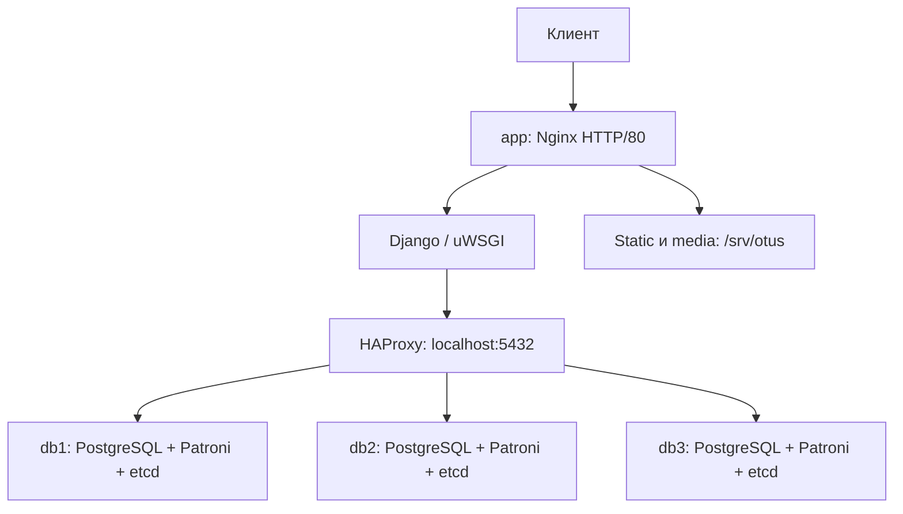

# ДЗ06. Кластер PostgreSQL с Patroni

## Цель работы

Развернуть отказоустойчивый кластер PostgreSQL с Patroni, настроить
сервис-дискавери и маршрутизацию к ведущему узлу. Подключить веб-портал
по материалам ДЗ04 и проверить работу при отказе лидера.

## Реализованное решение

Django-портал использует три узла PostgreSQL 16 под управлением Patroni.
etcd хранит состояние кластера и обеспечивает выбор лидера. HAProxy проверяет
роль узла через Patroni и направляет подключения к текущему ведущему.
После фейловера адрес подключения приложения не меняется.

Terraform создаёт инфраструктуру Selectel, Ansible-роли настраивают серверы.
На отдельной ВМ приложения размещены Nginx, Django/uWSGI, HAProxy, static и media.
Включена синхронная репликация с одной синхронной репликой.

Код разделён на модули создания инфраструктуры, настройки серверов и проверок.
Это позволяет использовать наработки в следующих, более сложных проектах.
Для выполнения ДЗ06 используются единые команды управления стендом.

## Архитектура



| Узлы | Количество | vCPU / RAM на ВМ | Диск на ВМ |
| --- | ---: | --- | --- |
| PostgreSQL, Patroni, etcd | 3 | 2 / 4 ГиБ | SSD 20 ГБ |
| Nginx, Django/uWSGI, HAProxy | 1 | 1 / 2 ГиБ | SSD 20 ГБ |

Узлы БД размещаются на разных физических хостах по правилу anti-affinity.
У приложения один публичный IPv4; ВМ БД используют приватные адреса.
Сеть — `10.66.0.0/24`, префикс ресурсов — `otus-dz06`.
База хранится на дисках PostgreSQL-узлов, media — на ВМ приложения.

Selectel используется для размещения ВМ и управления их питанием при проверке.
Три участника etcd сохраняют кворум при отказе одного узла.
HAProxy выбран для маршрутизации по роли, которую сообщает Patroni через `/primary`.

## Соответствие заданию

| Требование | Реализация и подтверждение |
| --- | --- |
| PostgreSQL с Patroni | Три узла, автоматический выбор лидера |
| Сервис-дискавери | etcd, API v3 |
| Балансировщик | HAProxy с проверкой `/primary` |
| Данные веб-портала | Миграции Django и [собственная фикстура](docs/migration.md) по материалам ДЗ04 |
| Проверка отказоустойчивости | [Отказ лидера и восстановление](docs/testing.md) |
| Код, конфигурации и инструкция | Terraform, Ansible, скрипты и обезличенные JSON-отчёты |

## Пошаговое развёртывание и проверка

Все команды выполняются локально в PowerShell из корня клона ДЗ06.
Нужны Python 3.12+, Git, OpenSSH и Terraform 1.6–1.x.
До запуска подготовьте собственный проект и сервисного пользователя Selectel
по [инструкции](docs/setup.md). Другие репозитории для запуска не требуются.

Однократная подготовка локальных инструментов:

```powershell
.\scripts\setup.ps1
# Если Terraform отсутствует в PATH, вместо команды выше:
# .\scripts\setup.ps1 -TerraformPath C:\Tools\terraform.exe
```

Ввод реквизитов в окружение текущей сессии без записи в файл;
пароль вводится скрыто:

```powershell
. .\scripts\env.ps1
```

Для разработки доступны явное сохранение и загрузка реквизитов;
варианты описаны в [подготовке](docs/setup.md).

Развернуть стенд и оставить его работающим:

```powershell
.\.tools\venv\Scripts\python.exe scripts/lab.py deploy
if ($LASTEXITCODE -ne 0) { throw 'Ошибка deploy; сохраните файлы восстановления' }
```

Серверы Ubuntu 24.04 настраиваются через Ansible на ВМ приложения;
устанавливать Ansible или WSL на рабочий компьютер не требуется.
Схема БД создаётся миграциями. Начальные данные подготовлены по материалам
ДЗ04 и загружаются Django-фикстурой. Повторный `deploy` применяет конфигурацию
без повторной загрузки начальных данных и сохраняет пользовательские записи и media.
При ошибке существующий стенд и файлы восстановления сохраняются.

Проверить приложение, фейловер и возвращение выключенного узла:

```powershell
.\.tools\venv\Scripts\python.exe scripts/lab.py verify
if ($LASTEXITCODE -ne 0) { throw 'Проверка не пройдена; сохраните стенд и диагностику' }
```

Открыть портал:

```powershell
.\.tools\venv\Scripts\python.exe scripts/lab.py open
```

На главной странице доступны шесть учебных материалов. Контрольные статьи
проверок не публикуются. Ссылки на исходники ведут на `develop`;
явно заданные ссылки на PR сохраняются.

## Результаты

| Проверка | Подтверждённый результат |
| --- | --- |
| Развёртывание и повторный deploy | Пройдены в Selectel ru-9a; данные сохранены |
| Размещение БД | [Три ВМ на трёх физических хостах](docs/placement-result.json) |
| Отказ лидера | [При отключении db2 лидером стал db3](docs/failover-result.json) |
| Восстановление | [db2 вернулся в кластер; все три узла работают](docs/recovery-result.json) |
| Приложение и данные | Чтение, запись, сохранность подтверждённых записей и media проверены |
| Удаление | [State и API подтвердили отсутствие ресурсов и floating IP](docs/cleanup-result.json) |

[Итог ручной проверки](docs/manual-verification-result.json) объединяет
результаты. Команды, ожидаемое поведение и исходные отчёты приведены
в [описании проверок](docs/testing.md).

## Ограничения

Проверяется отказ отдельной ВМ БД. Все узлы находятся в одной зоне.
Приложение, HAProxy и media размещены на одной ВМ, которая остаётся
единственной точкой отказа. Сетевые разделения и зависания не входят
в выполненные испытания. Потеря синхронных реплик может блокировать запись.
Репликация не заменяет резервное копирование.

## Удаление

Команда необратимо удаляет собственный стенд ДЗ06 и его данные:

```powershell
.\.tools\venv\Scripts\python.exe scripts/lab.py destroy
if ($LASTEXITCODE -ne 0) { throw 'Удаление не подтверждено; сохраните state, контекст, ключи и реквизиты для повторного destroy' }
```

После подтверждения удаления через state и API очищаются служебные файлы.
Реквизиты разработки удаляются отдельно, только после успешного `destroy`:

```powershell
Remove-Item -LiteralPath .\.local\operator.json -ErrorAction SilentlyContinue
. .\scripts\env.ps1 -Clear
```

## Структура репозитория

| Путь | Назначение |
| --- | --- |
| [terraform-selectel/](terraform-selectel/) | ВМ, сеть, диски и правила доступа |
| [ansible/](ansible/) | Настройка etcd, Patroni, HAProxy и портала |
| [scripts/](scripts/) | Единые команды развёртывания, проверки и удаления |
| [config/](config/) | Параметры стенда и схема реквизитов |
| [app/](app/) | Django-портал и начальная фикстура |
| [docs/setup.md](docs/setup.md) | Подготовка собственного окружения |
| [docs/migration.md](docs/migration.md) | Загрузка данных |
| [docs/testing.md](docs/testing.md) | Проверки и итоговые доказательства |
